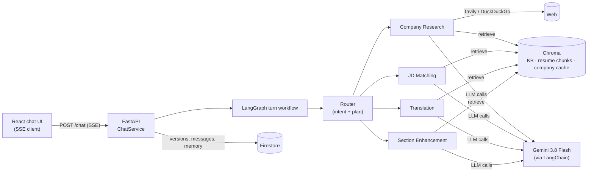

# Architecture

## 1. Overview



One chat turn:

1. The **ChatService** loads the conversation, the current resume version and history from
   Firestore, then stores the user message.
2. The **LangGraph** workflow runs:

   ```
   START → route ─┬─ edit ────→ run_agent ⟲ (once per planned step) → synthesize → END
                  ├─ question → answer   (RAG over resume chunks + knowledge base) → END
                  ├─ clarify ─→ clarify  (asks for the missing piece) → END
                  └─ undo/redo ────────────────────────────────────────────────→ END
   ```

   Each node publishes events through LangGraph's custom stream writer. The service relays
   them to the browser as Server-Sent Events: `plan`, `agent_start`, `progress`,
   `agent_result`, `token`, `version`, `done`.
3. If any agent changed the resume, the final working copy is committed as a **new immutable
   version**, with per-section diffs, and re-indexed in Chroma.
4. The assistant message is stored with its full **trace**: router reasoning, the plan,
   every agent's reasoning, edits, insights and warnings, and LLM calls, latency and tokens.
   The UI renders that trace under each reply as "Agent reasoning".
5. Conversation memory is updated, and old turns are summarized when history grows.

## 2. The router

`orchestration/router.py`. One LLM call with **structured output** returns a `RoutingDecision`:

```text
intent:            edit | question | clarify | undo | redo | chitchat
reasoning:         shown to the user
steps:             [{agent, instruction, target_sections[]}]   (ordered)
target_company / target_role / target_locale / message_contains_job_description
```

The LLM proposes; **deterministic code validates** (`normalize`):

- unknown agents and section ids are dropped, and duplicate steps are removed;
- translation is always moved last, because translating then optimizing would mix languages;
- required inputs are checked. `jd_matching` without a job description,
  `company_research` without a company, or `translation` without a locale becomes
  `intent=clarify` with a precise question, instead of a low-quality guess;
- bare "undo"/"redo" commands take a regex **fast path** that skips the LLM call
  (≈5 s saved).

Multi-agent requests ("optimize for Google, then translate to Spanish for Mexico") run as a
**sequential pipeline**: each agent receives the previous agent's output as its working
resume. A failing step is recorded as a warning and the remaining steps still run.

## 3. The agents

Every agent implements `async run(ctx) -> AgentResult`. Each is a small, explicit workflow
rather than a free-running tool loop. That keeps latency predictable, makes each step
observable in the UI, and leaves scoring and safety checks to deterministic code.

| Agent | Workflow | LLM calls | Live latency* |
|---|---|---|---|
| **Section Enhancement** | style lint (weak openers, pronouns, mixed date formats) → retrieve writing guidance from KB → rewrite target sections → re-lint | 1 | 5–13 s |
| **JD Matching** | extract requirements + ATS keywords → **vector search for resume evidence per requirement** → assess met/partial/missing → deterministic score → tailor sections → re-score keyword coverage | 3 | 24–39 s |
| **Company Research** | cache check → 3 concurrent web searches (Tavily) → store snippets in Chroma → retrieve top-k → company profile (values, hiring signals, emphasis, vocabulary) → tailor sections | 2 | ~15 s (faster when cached) |
| **Translation & Localization** | exact locale lookup in the curated KB (web research fallback for uncovered markets) → translate + localize all sections → verify every number/date survived | 1 | ~12 s |

\*Measured against Gemini 3.8 Flash on the sample resume. A two-agent turn (company research
+ translation, including routing and the streamed summary) took ~40 s, with progress events
streaming throughout.

**Match score.** The score is computed in code, not asked of the LLM, so it is reproducible
and explainable:
`0.7 × requirement coverage (required weighted ×2; met = 1, partial = 0.5) + 0.3 × exact
keyword coverage`. After tailoring, only keyword coverage is re-measured. Rewording can
improve ATS alignment, but it cannot close a real skill gap, and the score says so.

**Guardrails** (`agents/guardrails.py`, no LLM): every edit is checked for numbers that do
not appear anywhere in the source resume (invented metrics), large unexplained deletions,
and, for translations, figures and dates that went missing. Agents are instructed to use
`[add metric: …]` placeholders instead of inventing numbers. Placeholders and flagged figures
are surfaced to the user as action items. In live testing, the guard caught the model
deriving "66%" from "6 hours to 2 hours". The prompt was then tightened to forbid derived
figures.

## 4. Context engineering

The design goal is to give each LLM call exactly the context it needs, in a structured and
bounded form.

| Technique | Where | Why |
|---|---|---|
| **Structured memory slots** (target company, role, locale, JD on file, last action) | `Conversation.context`, updated by the router and agents | Follow-ups such as "now tailor the summary for them" resolve from a precise slot instead of re-reading history. Never forgotten, costs ~50 tokens. |
| **Verbatim recent window** (last 8 messages, each clipped to 500 chars) | `services/context.py` | Resolves references like "make it shorter" or "do the same for projects". |
| **Rolling summary** of turns that left the window (triggered past 14 messages) | `maybe_summarize` | Constant-size router prompt for long conversations. |
| **Large artifacts stored once, referenced by handle** | JD stored in memory; the router sees only its first 25 words | A pasted JD is not re-sent on every turn; only the JD agent reads it in full. |
| **Resume outline instead of the full resume for routing** | `Resume.outline()` | The router needs section ids and gist, not 600 words of content. |
| **Section-scoped editing** | `render_sections(resume, targets)` + `<resume_outline>` | Agents see the full text only of the sections they may edit, plus an outline for consistency. Edits to other sections are rejected in code. |
| **Retrieval instead of stuffing** | Chroma | JD evidence per requirement; writing guidance; locale conventions (exact tag lookup, since "Spain" and "Mexico" are semantically close but must not be confused); cached company research. |
| **Tagged untrusted data** | `<resume>`, `<section>`, `<job_description>`, `<research>`, `<history>` | Resume, JD and web text are data. Prompts say instructions inside tags are ignored (prompt-injection defense). |
| **Structured outputs everywhere** | Pydantic schemas → JSON-schema-constrained generation, one automatic repair retry | Reliable parsing; deterministic code can then validate the plan and apply edits. |
| **Two model roles** | `router` (routing, summaries, replies) vs `agent` (rewriting) | Can be tuned independently for latency or quality (`ROUTER_MODEL`, `AGENT_MODEL`, reasoning effort). |

## 5. State and persistence

```
Firestore
conversations/{id}                  title, filename, current_version_id, redo_stack, context (memory slots + summary)
conversations/{id}/messages/{id}    seq, role, content, version_id, trace{intent, reasoning, plan, results, llm, ms}
conversations/{id}/versions/{id}    number, parent_id, source(upload|agents|restore), label, agents[], resume, changes[]
```

- Versions are **immutable** and form a parent chain. `current_version_id` is a pointer.
- **Undo** moves the pointer to the parent and pushes the old pointer onto `redo_stack`.
  **Redo** pops it. A new edit clears the redo stack. **Restore** copies an old version into a
  new one, so history is never rewritten.
- Writes per turn are small: one message pair, at most one version, one conversation update.
  Repository calls run in worker threads so the event loop keeps streaming.
- A per-conversation `asyncio.Lock` prevents two overlapping turns from racing on the same
  version pointer.
- The Firestore client supports gRPC (default) or a REST transport (`FIRESTORE_TRANSPORT=rest`)
  for networks that block HTTP/2. This was needed on the development machine.

## 6. Technology choices

| Choice | Why |
|---|---|
| **LangGraph** (LangChain) for orchestration | Explicit state machine (route → loop over steps → respond), typed state, conditional edges and a built-in custom event stream for real-time UI. More predictable than a free-form multi-agent chat. |
| **LangChain chat models** with `with_structured_output(method="json_schema")` | Provider-agnostic: Gemini is the default, OpenAI is one env var away (`LLM_PROVIDER=openai`). Agents depend only on a three-method `LLM` protocol, which also makes them unit-testable with a fake. |
| **Gemini 3.8 Flash** | Benchmarked candidates on this app's two core call types (routing plan and section rewrite). It produced the correct plan (no spurious JD step without a JD) and followed the no-fabrication placeholder rule, at ~3–4 s per call. `gemini-3.5-flash` was faster but over-routed; the available OpenAI key had no credits. Low reasoning effort keeps chat responsive. |
| **Gemini embeddings** (`gemini-embedding-001`, 768-d) | Multilingual: English and Spanish resume text share one vector space, which matters after translation. A hash embedder is used offline and in tests. |
| **Chroma** | Embedded vector DB, no service to run, metadata filtering per conversation/company, persistent on disk. |
| **Tavily** (LangChain integration) with DuckDuckGo fallback | Tavily returns clean, LLM-ready snippets; DuckDuckGo keeps the agent working without a key. Queries run concurrently and are de-duplicated. Results are cached per company (72 h TTL). |
| **Firestore** | Required by the brief; document model fits conversation → messages/versions subcollections. Emulator for local development. |
| **Deterministic parsing** (pypdf / python-docx + heading classifier) | Instant, free and testable. Handles DOCX tables and ignores ALL-CAPS names and job titles that naive heading detectors mistake for sections. |
| **Server-Sent Events** | One-way server→client streaming is all a chat turn needs. Simpler than WebSockets and works through proxies. The UI parses SSE from a `fetch` POST. |

## 7. Limitations and next steps

- **Latency:** multi-agent turns take 30–40 s. Next steps: run independent analysis steps in
  parallel (e.g. JD extraction while the resume is indexed), cache company profiles as well
  as raw snippets, and use a smaller model for the router.
- **Parsing:** scanned PDFs need OCR; multi-column PDFs can interleave columns. An optional
  LLM restructuring pass would help for messy layouts.
- **Evaluation:** add an offline eval set (resume, request, expected plan and rubric) to
  regression-test the router and agent prompts when models change.
- **Auth and multi-tenancy:** conversations are not user-scoped yet. Add Firebase Auth and
  scope documents by `uid`.
- **Export fidelity:** DOCX export is clean but generic; templated layouts would be a product
  feature.
