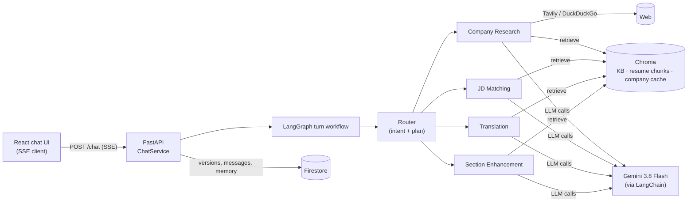

# Architecture

## 1. Overview



One chat turn:

1. The **ChatService** loads the conversation, the current resume version and history from
   Firestore, then stores the user message.
2. The **LangGraph** workflow runs:

   ```
   START → route ─┬─ edit ────→ run_agent ⟲ (once per planned step) → synthesize → END
                  ├─ question → answer   (RAG over resume chunks + knowledge base) → END
                  ├─ clarify ─→ clarify  (asks for the missing piece) → END
                  └─ undo/redo ────────────────────────────────────────────────→ END
   ```

   Each node publishes events through LangGraph's custom stream writer. The service relays
   them to the browser as Server-Sent Events: `plan`, `agent_start`, `progress`,
   `agent_result`, `token`, `version`, `done`.
3. If any agent changed the resume, the final working copy is committed as a **new immutable
   version**, with per-section diffs, and re-indexed in Chroma.
4. The assistant message is stored with its full **trace**: router reasoning, the plan,
   every agent's reasoning, edits, insights and warnings, and LLM calls, latency and tokens.
   The UI renders that trace under each reply ("Show what the agent did").
5. Conversation memory is updated, and old turns are summarized when history grows.

## 2. Routing cascade

Routing runs on every turn, so it has to be fast. Cheaper tiers go first, and the first tier
that is sure decides:

| Tier | Latency | Cost | Decides when |
|---|---|---|---|
| **Preset** (suggested-action chip) | ~0 ms | $0 | The user clicked a suggestion: the plan is predefined, so no classification is needed |
| **Rules** | ~0 ms | $0 | Bare `undo` / `redo` / small talk |
| **Cache** | ~0 ms | $0 | Exact repeat (normalized text + memory slots + resume language/sections); never for context-dependent wording such as "same" or "them" |
| **Fast classifier** | ~0.5 s | ~$0 | Embedding kNN over labelled example requests, plus rule-based slot extraction (language→locale, company, sections, role). Abstains on low confidence, compound requests, questions, or missing slots |
| **LLM router** | ~1.1 s | ~$0.0005 | Everything else: lite model with structured output |

The classifier runs **speculatively in parallel** with the LLM router. When it is confident, the
LLM call is cancelled; when it abstains, the LLM answer is already in flight, so abstaining adds
no latency. The cancelled call is still metered, because the provider may bill the input it
already read.

**Evaluation methodology** (`backend/evals/routing_eval.py`, data in `routing_cases.py`):

- **Split:**
  - 23 *calibration* cases are the only data used to choose the classifier's thresholds:
    highest coverage at 100% precision, from a 10 × 11 grid sweep.
  - 30 *held-out* cases are used only for scoring: unseen paraphrases and new requests.
  - A test guards the split against exact and near-duplicate overlap with calibration cases and
    the classifier's examples.
- **Strict scoring:** exact intent, exact ordered agent list, exact canonical slot values.
- **Genuine baseline:** `route(mode="llm_only")` bypasses presets, rules, cache *and*
  classifier.
- **Latency:**
  - warm-up calls are discarded;
  - each case is repeated 3×, with the two modes interleaved to cancel drift;
  - results are reported as median and p95;
  - the route cache is disabled, so repeats can't hit it.
- **Cost:** billed cost of completed LLM and embedding calls, plus an upper bound for cancelled
  speculative calls.

Held-out results (30 cases × 3 runs per mode; saved in `backend/evals/results/routing_eval.json`):

| Router | Accuracy | Stable cases | Median | p95 | Billed per request | Decided by |
|---|---|---|---|---|---|---|
| LLM only (lite) | 100% | 30/30 | 1.04 s | 1.44 s | $0.00049 | LLM 90 |
| Cascade | 100% | 30/30 | **0.42 s** | 1.31 s | $0.00022 (+ ≤ $0.00011 cancelled) | classifier 42 · LLM 39 · rules 9 |

The classifier answered 47% of held-out requests with 100% precision, at the thresholds chosen
on the calibration split (`min_confidence=0.55`, `min_similarity=0.76`). Even counting the
cancelled speculative calls at their upper bound, the cascade costs less than the LLM-only
router.

**Caveat:** 30 cases is a small test set. 100% means the true error rate is below ~10% with 95%
confidence (rule of three), not that routing is never wrong. The set should grow with real
traffic.

Calibration mattered:
- A first version of the classifier reached only 85%. Embeddings cannot tell "tailor my resume
  for Google" from "tailor my resume to this job"; that distinction is structural, so it is now
  resolved by explicit cues (a named company vs. posting words).
- A later threshold change exposed a gap in compound detection: "optimize it for Google *and*
  translate it" was answered as a single step. The classifier now abstains on "and" + an action
  verb, and whenever a language is named but the label isn't translation.

## 3. The router (LLM tier)

`orchestration/router.py`. One LLM call with **structured output** returns a `RoutingDecision`:

```text
intent:            edit | question | clarify | undo | redo | chitchat
reasoning:         shown to the user
steps:             [{agent, instruction, target_sections[]}]   (ordered)
target_company / target_role / target_locale / message_contains_job_description
```

The LLM proposes; **deterministic code validates** (`normalize`):

- unknown agents and section ids are dropped, and duplicate steps are removed;
- translation is always moved last, because translating then optimizing would mix languages;
- required inputs are checked. `jd_matching` without a job description,
  `company_research` without a company, or `translation` without a locale becomes
  `intent=clarify` with a precise question, instead of a low-quality guess;
- bare "undo"/"redo" commands take a regex **fast path** that skips the LLM call
  (≈5 s saved).

Multi-agent requests ("optimize for Google, then translate to Spanish for Mexico") run as a
**sequential pipeline**: each agent receives the previous agent's output as its working
resume. A failing step is recorded as a warning and the remaining steps still run.

## 4. Plans, models and cost

`app/plans.py` maps three LLM roles to models per plan. Agents are plan-agnostic: `TieredLLM`
picks the model of the conversation's plan for every call through a context variable.

| Plan | Routing | Agents | Reply | Measured on a real resume |
|---|---|---|---|---|
| Free | 3.5 Flash-Lite | 3.5 Flash-Lite | 3.5 Flash-Lite | translate preset 4.8 s / $0.005; skills edit 4.9 s / $0.002 |
| Pro | 3.5 Flash-Lite | 3.8 Flash | 3.5 Flash-Lite | translate preset 9.4 s / $0.010 |
| Premium | 3.5 Flash-Lite | 3.8 Flash (medium reasoning) | 3.8 Flash | deeper analysis, highest cost |

The router and the reply use the lite model on every plan: routing scores 100% on the held-out eval
with it, and the reply only summarizes structured results. Spend goes where quality shows,
which is the agents' rewriting. Costs are computed from real token usage × the published
Gemini prices (USD per 1M tokens: 3.5 Flash-Lite $0.30 in / $2.50 out; 3.8 Flash $0.75 / $3.75,
an introductory rate through 2026). They are shown per LLM call, per node, per reply and per plan.

### LLM client robustness (`app/llm/client.py`)

- **Explicit roles:** every client maps router, agent *and* reply. A missing role fails at
  start-up instead of silently using another role's model. OpenAI has its own reply model.
- **Model fallback:** if a model rejects a request as unsupported (400/404/422, "unsupported",
  "response_schema"), structured output retries with function calling on the same model, then
  a configured fallback model. A stream can fall back only before its first token. Rate limits,
  auth failures, timeouts and 5xx errors are never masked.
- **Metering in `finally`:** every LLM and embedding call is recorded as `ok`, `error` or
  `cancelled`, including a reply stream the user abandons and a cancelled speculative router
  call. Incomplete calls carry estimated tokens and are reported as an upper bound, never mixed
  into billed cost. The trace is captured when the call starts, and streams are closed with
  `aclosing`, so a late close still lands in the right turn.

**Is LangSmith worth it here?** For this scope, the in-process trace is enough, and it is
product data rather than just debugging data:
- it powers the Agent flow view and per-reply cost;
- it is persisted with each message;
- it works offline and in tests.

LangSmith adds value at team or production scale: cross-run search, prompt and dataset
versioning, eval runs over stored datasets, and dashboards. Because the app is built on
LangChain, it can be switched on with environment variables only (`LANGSMITH_TRACING=true`,
`LANGSMITH_API_KEY=…`; older versions use `LANGCHAIN_TRACING_V2`). That sends prompts, which
contain resume content, to a hosted service, so it should be an explicit opt-in.

## 5. Performance work (measured)

| Problem (seen in the flow view) | Fix | Before → after |
|---|---|---|
| Translation wrote the whole resume in one long LLM call | One small planning call (headings, notes) in parallel with one call per section | 30.7 s → 7.8 s (Pro), 2.5 s (Free) |
| JD agent embedded each requirement separately | One batched embedding + one Chroma query; extraction and indexing run concurrently; requirements cached per JD | ~5 s of retrieval → 1 call |
| Every turn listed all messages (with full traces) and all versions | Recent-N query with field projection; latest version number via a 1-field query | history 1.45 s → 0.11 s; version 0.9 s → ~0.1 s |
| Re-embedding the new version blocked the reply | Background task; only steps that read the index wait for it | −1.3 s per editing turn |
| Undo/redo re-read Firestore and re-embedded synchronously | Write-through LRU cache of conversations, immutable versions and messages; re-index in background; UI no longer re-fetches the version list | undo/redo 1.5 s → 13–15 ms |
| Nested trace/resume maps were slow to (de)serialize | Large nested fields stored as JSON strings (legacy documents still readable) | cold conversation load 1.81 s → 0.67 s |
| Retries could re-run a whole turn | Idempotency key per message; stored answer replayed | retry 0.4 s, no agent work |

| PDF export rendered on click (~250 ms) | Trimmed, unhinted fonts; per-version cache (versions are immutable); background pre-render when a version is saved | first download ~150 ms → served from cache in 4–20 ms |

Each reply's trace records `timings_ms` (prepare, graph and persist), so regressions are visible.

## 6. The agents

Every agent implements `async run(ctx) -> AgentResult`. Each is a small, explicit workflow
rather than a free-running tool loop. That keeps latency predictable, makes each step
observable in the UI, and leaves scoring and safety checks to deterministic code.

| Agent | Workflow | LLM calls | Agent latency* (Free / Pro) |
|---|---|---|---|
| **Section Enhancement** | style lint (weak openers, pronouns, mixed date formats) → retrieve writing guidance from KB → rewrite target sections → re-lint | 1 | 1.7 s / 4.2 s |
| **JD Matching** | extract requirements + ATS keywords (cached per JD) ‖ index resume → **one batched vector search for evidence of every requirement** → assess met/partial/missing → deterministic score → tailor sections → re-score keyword coverage | 3 | 10 s / 23 s |
| **Company Research** | cache check → 3 concurrent web searches (Tavily) → store snippets in Chroma → retrieve top-k → company profile (values, hiring signals, emphasis, vocabulary) → tailor sections | 2 | 4 s / 15 s (faster when cached) |
| **Translation & Localization** | exact locale lookup in the curated KB (web research fallback for uncovered markets) → **localization plan ‖ every section translated in parallel** → verify every number/date survived | 1 + N (parallel) | 1.7–2.5 s / 6–8 s |

\*Measured with `backend/evals/agent_benchmark.py` and live turns on real resumes. A full
editing turn on Free takes about 4–5 s end to end (routing, agent, streamed reply, versioning).

**Match score.** The score is computed in code, not asked of the LLM, so it is reproducible
and explainable:
`0.7 × requirement coverage (required weighted ×2; met = 1, partial = 0.5) + 0.3 × exact
keyword coverage`. After tailoring, only keyword coverage is re-measured. Rewording can
improve ATS alignment, but it cannot close a real skill gap, and the score says so.

**Guardrails** (`agents/guardrails.py`, no LLM): every edit is checked for numbers that do
not appear anywhere in the source resume (invented metrics), tools or names the edited
section (or, for a selected-line edit, the line itself) never mentioned, large unexplained
deletions, and, for translations, figures and dates that went missing. A skill listed under
Skills is not evidence that a particular bullet used it, so "migrated MySQL to PostgreSQL
using BigQuery" is flagged even though BigQuery appears elsewhere. Job matching also lists
every posting keyword its edit introduced, so the user confirms each one is true instead of
it silently raising the keyword score. Agents are instructed to use
`[add metric: …]` placeholders instead of inventing numbers. Placeholders and flagged figures
are surfaced to the user as action items. In live testing, the guard caught the model
deriving "66%" from "6 hours to 2 hours". The prompt was then tightened to forbid derived
figures.

### Line-targeted edits

"Change these two lines" must change exactly those lines. Leaving that to the LLM is not
enough: a router that only says `target_sections: ["experience"]` gives the agent the whole
section, and a rewrite of the whole section follows. So the scope is enforced in code:

1. `orchestration/line_targets.py` matches the message against the resume line by line:
   lines selected in the UI, pasted lines and quoted spans. A candidate counts when it is
   contained in a resume line or matches it with a similarity of at least 0.82. More than eight
   matches means a pasted block, which is not treated as a target.
2. When the intent is an edit, `scope_to_lines` narrows the plan to the Section Enhancement
   agent with `target_lines` (a translation step is kept). Line-scoped plans are never cached,
   because the same words can point at different lines in the next version.
3. In line mode the agent sees the section with numbered lines and returns
   `{line_id, replacement}` pairs. Code applies only those replacements, keeps bullet markers
   and leaves every other line unchanged.

The UI sends a selection with the message ("Edit selection" on highlighted resume text), shows
the targeted lines in the agent's flow node, and shows each edit as before → after.

## 7. Context engineering

The design goal is to give each LLM call exactly the context it needs, in a structured and
bounded form.

| Technique | Where | Why |
|---|---|---|
| **Structured memory slots** (target company, role, locale, JD on file, last action) | `Conversation.context`, updated by the router and agents | Follow-ups such as "now tailor the summary for them" resolve from a precise slot instead of re-reading history. Never forgotten, costs ~50 tokens. |
| **Verbatim recent window** (last 8 messages, each clipped to 500 chars) | `services/context.py` | Resolves references like "make it shorter" or "do the same for projects". |
| **Rolling summary** of turns that left the window (triggered past 14 messages) | `maybe_summarize` | Constant-size router prompt for long conversations. |
| **Large artifacts stored once, referenced by handle** | JD stored in memory; the router sees only its first 25 words | A pasted JD is not re-sent on every turn; only the JD agent reads it in full. |
| **Resume outline instead of the full resume for routing** | `Resume.outline()` | The router needs section ids and gist, not 600 words of content. |
| **Section-scoped editing** | `render_sections(resume, targets)` + `<resume_outline>` | Agents see the full text only of the sections they may edit, plus an outline for consistency. Edits to other sections are rejected in code. |
| **Retrieval instead of stuffing** | Chroma | JD evidence per requirement; writing guidance; locale conventions (exact tag lookup, since "Spain" and "Mexico" are semantically close but must not be confused); cached company research. |
| **Tagged untrusted data** | `<resume>`, `<section>`, `<job_description>`, `<research>`, `<history>` | Resume, JD and web text are data. Prompts say instructions inside tags are ignored (prompt-injection defense). |
| **Structured outputs everywhere** | Pydantic schemas → JSON-schema-constrained generation, one automatic repair retry | Reliable parsing; deterministic code can then validate the plan and apply edits. |
| **Two model roles** | `router` (routing, summaries, replies) vs `agent` (rewriting) | Can be tuned independently for latency or quality (`ROUTER_MODEL`, `AGENT_MODEL`, reasoning effort). |

### Execution flow view

`services/flow.py` turns each turn's stream events into an n8n-style node graph:
`trigger → router → agent(s) → reply → version`. Every node has a status (pending,
running, done, error or skipped), start/end offsets, timed sub-steps (the agent's progress
messages) and the LLM calls it made, with model, latency and tokens. Two details keep it
accurate, because the graph runs ahead of the consumer of its event stream:

- each workflow node sets a context variable (`current_node`), and every LLM call is tagged
  with it;
- events carry their emit timestamp.

Snapshots stream as `flow` events, so the **Agent flow** tab animates live. The final
snapshot is stored in the message trace, so any past reply can be replayed with "View flow".

### Frontend design system

The Graphite design (chosen after exploring five token-based variants). Every component uses
design tokens only: colours, two type roles (Rajdhani for display, Saira for body), heading case
and tracking, the heading rule, radii and shadows. Nested rounded boxes follow
`inner radius = outer radius − padding`, computed per element in CSS (`--r-in`). Scrollbars,
selection colour and focus rings come from the same tokens.

Token usage is only reported when an LLM call ends, so during a turn the UI shows an estimate:
finished calls' real usage, plus streamed reply characters ÷ 4, plus elapsed time × 55 tokens/s
on calls still running (with a prompt-size allowance). When the turn finishes, the meter eases to
the exact count from the final flow snapshot.

### Export

**Original layout (default).** The uploaded file is stored with the conversation, and a
download edits *that file* (`services/layout_export.py`, PyMuPDF for PDF, python-docx for DOCX):

1. Every glyph of the PDF is read with its font, size, colour and position, and each line of the
   parsed original is located among them by its letters and digits.
2. The target version is diffed line by line against the original. For each changed line only
   its glyphs are redacted (removed from the file, not painted over); unchanged leading words,
   originally bold keywords and a right-aligned date keep their exact place.
3. The new words are drawn one by one on the old baselines. The original embedded font is reused
   when it has every new character with the original widths; otherwise the same font installed
   on the server, then Times/Helvetica/Courier by style, then bundled Noto Sans or a CJK font.
   Text wraps into the old line's space plus free space below it, shrinking to at most 82% size
   and 90% width; failing that, the whole line is re-flowed before giving up.
4. The output is read back: every new line must be present and every replaced line gone.

When the original cannot hold an edit (a PDF gaining lines or sections, a line that cannot be
located or no longer fits) the export falls back to the clean layout below and reports why
(`X-Export-Layout`/`X-Export-Note`, and a badge on each History card). DOCX files are edited
paragraph by paragraph and can take added lines. Replacement text is written after the rest of
the page in the PDF's content stream; layout-aware parsers read it in place, and our own
uploader recognizes these files and reads them in position order. Measured on 18 real PDFs:
original layout kept on 18/18 rewordings, 18/18 with ~15% longer bullets and 16/18 full rewrites
(0.3–0.4 s median, 1.2 s when every line changes, rendered in the background).

**Clean layout (fallback, or `layout=clean`).** `services/pdf_export.py` renders a single-column, ATS-friendly PDF with **fpdf2**: pure Python,
LGPL, no system libraries. The alternatives were WeasyPrint (needs GTK, slower), headless
Chrome (heavy) and PyMuPDF (fast, but AGPL). Details that matter for a resume:

- **Reading order**: each role's title is drawn before its right-aligned date, so ATS parsers
  and text extractors read "Role … Jan 2024 – Present", not the date first.
- **Fonts**: Noto Sans, trimmed to Latin, Greek, Cyrillic and Vietnamese and stripped of
  hinting (`scripts/build_pdf_fonts.py`: 610 KB → 130 KB). Fonts are parsed and subset for every
  document, so this is most of the speed-up. Other scripts (e.g. Japanese after a translation)
  use the first installed font that covers them, loaded only when needed
  (`PDF_FALLBACK_FONTS`, then common system paths). Decorative icons (✉ 📞) are dropped and
  bullet-like symbols drawn as •, rather than loading a large symbol font.
- **Fidelity**: entries use the same rules as the on-screen resume (title, subtitle, date,
  tech stack, bullets), but nothing is ever dropped from the file. `evals/extraction_check.py`
  reads every export back through the upload parser: ≥ 99.9% word recall on 21 real resumes.
- **Latency**: renders are cached per version and pre-rendered in the background when a
  version is saved, so a download is usually served from memory (4–20 ms).

## 8. State and persistence

```
Firestore
conversations/{id}                  title, filename, current_version_id, redo_stack, context (memory slots + summary)
conversations/{id}/messages/{id}    seq, role, content, version_id, trace{intent, reasoning, plan, results, llm, ms}
conversations/{id}/versions/{id}    number, parent_id, source(upload|agents|restore), label, agents[], resume, changes[]
```

- Versions are **immutable** and form a parent chain. `current_version_id` is a pointer.
- A **write-through cache** (`storage/cache.py`) sits in front of Firestore: reads of
  conversations, versions and messages are served from memory, and writes go to Firestore
  first. Because versions never change, caching them cannot serve stale data. The cache is
  per process (bounded LRU); several replicas would use Redis or per-conversation sticky
  routing behind the same interface.
- **Undo** moves the pointer to the parent and pushes the old pointer onto `redo_stack`.
  **Redo** pops it. A new edit clears the redo stack. **Restore** copies an old version into a
  new one, so history is never rewritten.
- Writes per turn are small: one message pair, at most one version, one conversation update.
  Repository calls run in worker threads so the event loop keeps streaming.
- A per-conversation `asyncio.Lock` prevents two overlapping turns from racing on the same
  version pointer.
- The Firestore client supports gRPC (default) or a REST transport (`FIRESTORE_TRANSPORT=rest`)
  for networks that block HTTP/2. This was needed on the development machine.

## 9. Technology choices

| Choice | Why |
|---|---|
| **LangGraph** (LangChain) for orchestration | Explicit state machine (route → loop over steps → respond), typed state, conditional edges and a built-in custom event stream for real-time UI. More predictable than a free-form multi-agent chat. |
| **LangChain chat models** with `with_structured_output(method="json_schema")` | Provider-agnostic: Gemini is the default, OpenAI is one env var away (`LLM_PROVIDER=openai`). Agents depend only on a three-method `LLM` protocol, which also makes them unit-testable with a fake. |
| **Gemini 3.5 Flash-Lite + 3.8 Flash** | Chosen by measurement (`backend/evals/`). Flash-Lite routes with 100% held-out accuracy at ~1.0 s median and runs agents 3–4× faster at about half the cost; 3.8 Flash writes the best rewrites and translations, so the paid plans use it for agents. The available OpenAI key had no credits. |
| **Gemini embeddings** (`gemini-embedding-001`, 768-d) | Multilingual: English and Spanish resume text share one vector space, which matters after translation. A hash embedder is used offline and in tests. |
| **Chroma** | Embedded vector DB, no service to run, metadata filtering per conversation/company, persistent on disk. |
| **Tavily** (LangChain integration) with DuckDuckGo fallback | Tavily returns clean, LLM-ready snippets; DuckDuckGo keeps the agent working without a key. Queries run concurrently and are de-duplicated. Results are cached per company (72 h TTL). |
| **Firestore** | Required by the brief; document model fits conversation → messages/versions subcollections. Emulator for local development. |
| **PyMuPDF** for original-layout export | The only library that can remove individual glyphs (true redaction) and reuse a PDF's embedded fonts. AGPL-licensed: a closed-source SaaS needs Artifex's commercial licence. |
| **fpdf2** for the clean PDF | Fast enough to pre-render every version (~150 ms per page set), pure Python with no system dependencies, LGPL. |
| **Deterministic parsing** (pypdf / python-docx + heading classifier) | Instant, free and testable. Handles DOCX tables and ignores ALL-CAPS names and job titles that naive heading detectors mistake for sections. |
| **Server-Sent Events** | One-way server→client streaming is all a chat turn needs. Simpler than WebSockets and works through proxies. The UI parses SSE from a `fetch` POST. |

## 10. Limitations and next steps

- **Latency:** on the Pro plan, single-agent edits take 6–16 s and JD matching 24–28 s; a
  two-agent request ~22 s (Free: ~4–5 s per edit). Next steps: run JD extraction while the
  resume is indexed, cache company profiles as well as raw snippets.
- **Original-layout PDFs:** a deleted line leaves a blank row (a PDF cannot reflow), and a PDF
  cannot gain lines or sections (the DOCX path can); those cases fall back to the clean layout.
  Link underlines drawn as graphics stay where they were if the linked text moves.
- **Parsing:** scanned PDFs need OCR; multi-column PDFs can interleave columns. An optional
  LLM restructuring pass would help for messy layouts.
- **Evaluation:** add an offline eval set (resume, request, expected plan and rubric) to
  regression-test the router and agent prompts when models change.
- **Auth and multi-tenancy:** conversations are not user-scoped yet. Add Firebase Auth and
  scope documents by `uid`.
- **Export:** PDF and DOCX use one clean layout; a choice of templates would be a product
  feature. Long resumes run to a second page (no automatic fit-to-one-page yet).
- **Parsing:** resumes that contain no name or contact details (seen in 2 of 21 real files)
  get an empty header; the UI could prompt for them.
